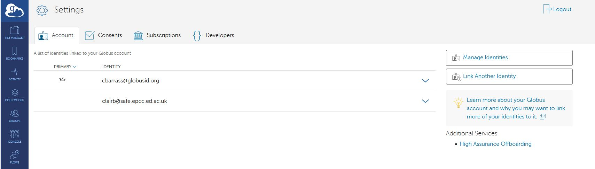
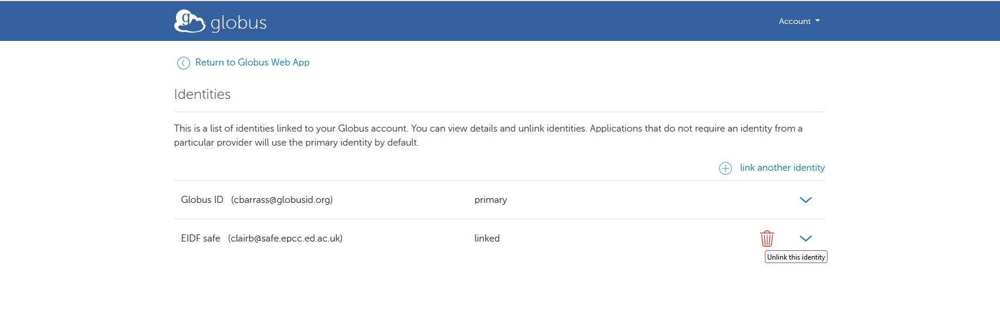

# Globus

Globus is a service that enables high-performance and convenient data transfer and sharing of large amounts of data.

- [Globus website](https://www.globus.org/)
- [Globus documentation and tutorials](https://docs.globus.org/guides/)

## Using Globus on Cirrus

The Cirrus file systems have Globus Collections (formerly known as an endpoint):

| Collection name | Cirrus file system |
|---|---|
| CephFS | /home |
| NAIDIN | /epccfs |

A full step-by-step guide on transferring data to/from Cirrus is provided below.

## Step-by-step example

### Setting up Cirrus file systems

1. Navigate to [https://app.globus.org](https://app.globus.org).
2. Log in with your Globus identity (this could be a globusid.org or other identity).
3. In File Manager, use the search tool to search for the relevant collection (i.e. "CephFS" or "NAIDIN"). Select it.
4. In the transfer pane, you are told that Authentication/Consent is required. Click *Continue*.
5. Click on the ARCHER2 Safe (safe.epcc.ed.ac.uk) link.
6. Select the correct User account (if you have more than one). Click *Accept*.
7. Now confirm your Globus credentials. click *Allow*.
8. The top-level Cirrus directory will be shown (i.e. `/home` or `/epccfs` ).
9. Navigate to the directory you want to transfer data to/from.

### Setting up the other end of the transfer

!!! tip "Make sure you select two-panel view mode"
    The following instructions assume you have selected two-panel view mode.

#### Laptop

1. If you wish to transfer data to/from your personal laptop or other device, click on the Collection Search in the right-hand panel
2. Use the link to “Get Globus Connect Personal” to create a Collection for your local drive.

#### Other server e.g. JASMIN 

If you wish to connect to another server, you will need to search for the Collection e.g. JASMIN Default Collection and authenticate

Please see the [JASMIN Globus page for more information](https://help.jasmin.ac.uk/docs/data-transfer/globus-transfers-with-jasmin/)

### Setting up and initiating the transfer

Once you are connected to both the Source and Destination Collections, you can use the File Manager to select the files to be transferred, and then click the Start button to initiate the transfer

- A pop-up will appear once the Transfer request has been submitted successfully
- Clicking on the “View Details” will show the progress and final status of the transfer

### Using a different ARCHER2 account

If you want to use Globus with a different account on Cirrus, you will have to go to Settings



Manage Identities



And Unlink the current SAFE identity, then repeat the link process with the other Cirrus account

## Globus Command Line Interface (CLI)

The Globus CLI is also available on Cirrus for transferring data. You can make it available with

```
module load globus-cli
```

For more information on use, see the [Globus CLI documentation](https://docs.globus.org/cli/).